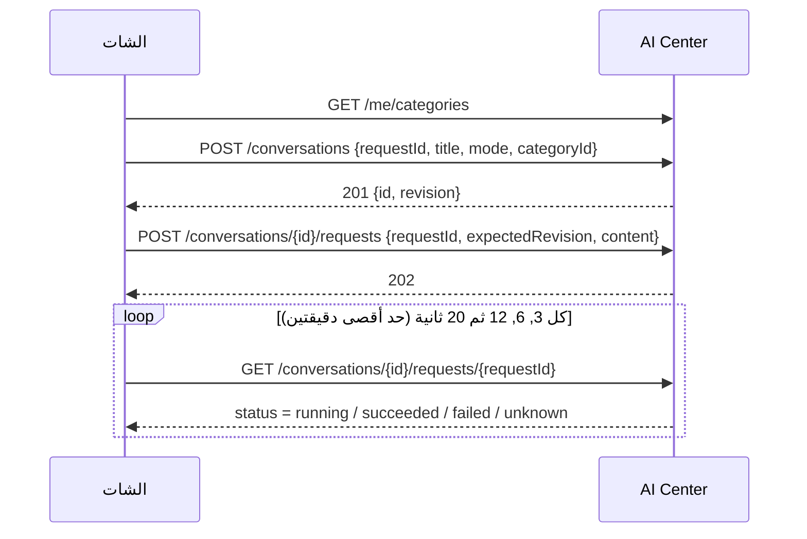

# شرح AI Center API (اسأل TAB)

المصدر: `ASK_TAB_BUTTON_GUIDE_FOR_HISHAM.md` وSwagger (`https://dev-ai-center-api.tab-erp.com/swagger/`).

## 1. الأساسيات

| البيئة | Base URL |
|---|---|
| Dev | `https://dev-ai-center-api.tab-erp.com/api/v1` |
| Staging | `https://staging-ai-center-api.tab-erp.com/api/v1` (لم يُجرَّب) |
| Prod | `https://ai-center-api.tab-erp.com/api/v1` (لم يُجرَّب) |

- الـ Headers المسموح بها فقط: `Authorization: Bearer <token>`، `Content-Type`، `Idempotency-Key`، `X-Tenant-ID`. لا نرسل tenant: الـ tenant يُقرأ من الـ token.
- الـ token لازم يكون فيه `ai_center` في `aud` (لذلك أضفنا scope `ai_center`).
- Timeout ٣٠ ثانية: أول call بعد الـ login ممكن ياخد ثواني.
- الحد: ١٢٠ request في الدقيقة.

## 2. ليه polling وليس response مباشر؟

السؤال يروح للـ AI وممكن ياخد من ثواني لدقيقة (يخطط، يشغل SQL على بيانات TAB، يكتب الإجابة).
لو انتظرنا الإجابة في نفس الـ request هيحصل timeout من الـ proxy أو المتصفح.
فالـ API **async**: يستقبل السؤال ويرد فورًا `202 Accepted`، وإحنا نسأل كل شوية "خلصت؟".
التوقيتات (3 ثم 6 ثم 12 ثم كل 20 ثانية، وتوقف عند دقيقتين) هي المطلوبة في الـ guide لتقليل الضغط والتكلفة.

## 3. الـ Endpoints المستخدمة

| Method | Path | الغرض | الرد |
|---|---|---|---|
| GET | `/me/categories` | الفئات المتاحة لليوزر (`id`, `name`, `nameAr`, `queryEnabled`, `suggestedQuestions`) | 200 |
| POST | `/conversations` | إنشاء محادثة | 201 (فيها `id`, `revision`) |
| GET | `/conversations/{id}` | قراءة المحادثة و`revision` الحالي | 200 |
| PATCH | `/conversations/{id}` | إعادة تسمية / أرشفة / استرجاع | 200 |
| GET | `/conversations?filter=&archived=false&offset=0&limit=25` | قائمة المحادثات | 200 |
| POST | `/conversations/{id}/requests` | إرسال سؤال | **202** |
| GET | `/conversations/{id}/requests/{requestId}` | حالة السؤال والإجابة (polling) | 200 |
| GET | `/conversations/{id}/requests?offset=0&limit=20` | تاريخ الأسئلة والإجابات | 200 |

## 4. الـ Flow



### إنشاء المحادثة
```json
{"requestId":"<uuid جديد>","title":"<أول 160 حرف من السؤال>","modelId":null,"mode":"tab-query","categoryId":"<id>"}
```
- `mode`: `tab-query` لو `queryEnabled = true` (سؤال على بيانات TAB)، وإلا `general`.
- `modelId: null`: السيرفر يختار الموديل.

### إرسال سؤال
```json
{"requestId":"<uuid جديد>","expectedRevision":<revision>,"content":"<السؤال، حتى 8000 حرف>"}
```

### حالات الرد
| status | نعرض |
|---|---|
| `running` | مؤشر كتابة ونكمل polling |
| `succeeded` | `answer` (Markdown) و`suggestedQuestions` (حتى 3) |
| `failed` | رسالة حسب `errorCode` |
| `unknown` | "تعذر التأكد من الإجابة"، **بدون إعادة إرسال تلقائي** |

## 5. الـ revision (منع التعارض)

كل محادثة لها `revision` يزيد مع كل تغيير. عند الإرسال نبعت `expectedRevision`؛ لو حد غيّر المحادثة (تاب تاني مثلًا) يرجع `409`.
لذلك قبل كل سؤال جديد نقرأ `GET /conversations/{id}` لنأخذ الـ revision الحالي.
في الكود: لو رجع 409 بسبب revision قديم (قبل تشغيل السؤال، بدون تكلفة) نقرأ الـ revision ونعيد مرة واحدة فقط.
ملاحظة: اسم الكود `STALE_REVISION` في الكود افتراض، Swagger يقول فقط "Stale revision returns 409" بدون اسم الكود؛ يُراجع مع Omar.

## 6. قواعد التكلفة

- `requestId` جديد لكل سؤال جديد. عند timeout أو خطأ شبكة في الإرسال نعيد **بنفس** `requestId` ونفس الـ body، والسيرفر لا ينفذه مرتين.
- لا إعادة إرسال تلقائي بعد `failed` أو `unknown`: كل محاولة قد تكلف فلوس.
- سؤال واحد في المرة لكل محادثة (وإلا `409 CHAT_REQUEST_RUNNING`).
- الأسئلة المقترحة: لو اليوزر بعتها بدون تعديل نضيف `"suggestion":{"requestId":"...","index":0-2}` (أرخص). لو رجع `409 SUGGESTION_CHANGED` تتبعت كسؤال عادي.

## 7. عرض الإجابة

- `answer` نص Markdown غير موثوق: نحوله بـ `marked` وننظفه بـ `dompurify` (بدون HTML خام، بدون صور، روابط `http(s)` فقط في تاب جديد).
- `dir="auto"` لأن لغة الإجابة تتبع لغة السؤال.
- الجداول العريضة لها scroll.
- لا نعرض حقل `query` (الـ SQL).

## 8. الأخطاء

الأخطاء `application/problem+json` فيها `status`, `code`, `detail`, `correlationId`. لا نعرض `code` أو `detail`، ونعرض `correlationId` كمرجع للدعم.

| الحالة | الرسالة |
|---|---|
| قائمة فئات فاضية | لا توجد فئات متاحة لك بعد. تواصل مع المسؤول. |
| 401 | انتهت جلستك. سجّل الدخول مجددًا. (بعد refresh واحد فقط) |
| 403 `APPLICATION_ACCESS_REQUIRED` | المنشأة غير مخوّلة بالوصول إلى مركز الذكاء الاصطناعي. |
| 403 `USER_SYSTEM_ACCESS_REQUIRED` / `PERMISSION_REQUIRED` | ليس لديك صلاحية استخدام اسأل TAB. |
| 403 `CATEGORY_ACCESS_DENIED` / `DATA_SCOPE_DENIED` | ليس لديك صلاحية لبيانات هذه الفئة. |
| 409 `CATEGORY_CHANGED` | تغيرت هذه الفئة. ابدأ محادثة جديدة. |
| 422 `MODEL_UNAVAILABLE` | لا يوجد نموذج متاح لك. |
| 429 | طلبات كثيرة. انتظر قليلًا. |
| غير ذلك | لم أتمكن من إكمال الإجابة هذه المرة. |

## 9. مين يقدر يستخدم الشات

كل الشروط دي لازم تتحقق:
1. الشركة مرخصة لنظام 80.
2. صلاحية View على `AiCenterAsk`.
3. اليوزر في Role مختار على الفئة (AI Center → Categories).
4. للفئات اللي على بيانات: صلاحية على النظام بتاع الفئة.

الصلاحيات تُقرأ مرة مع الـ login، فبعد أي تغيير لازم logout وlogin.
