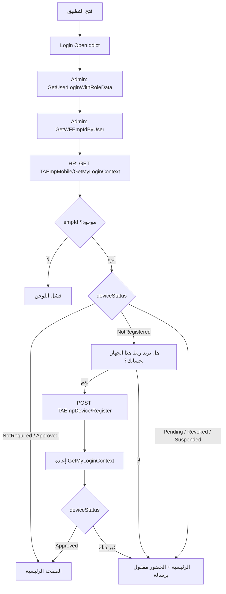
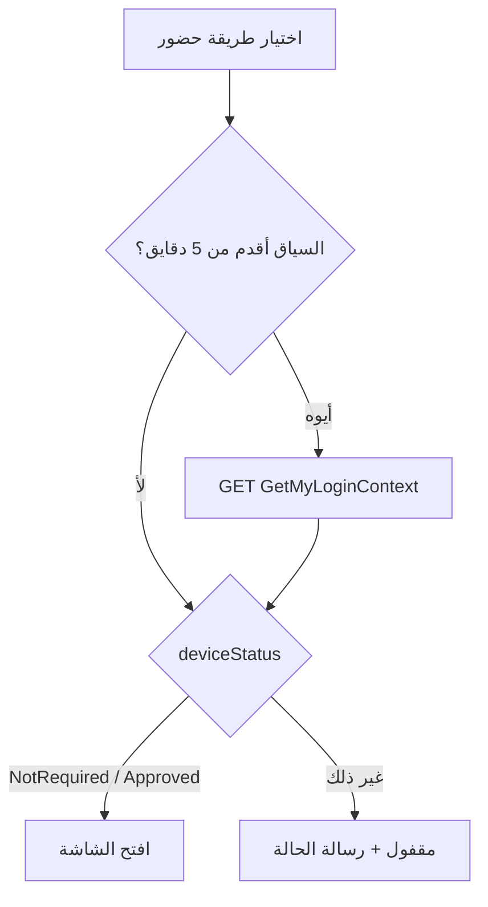
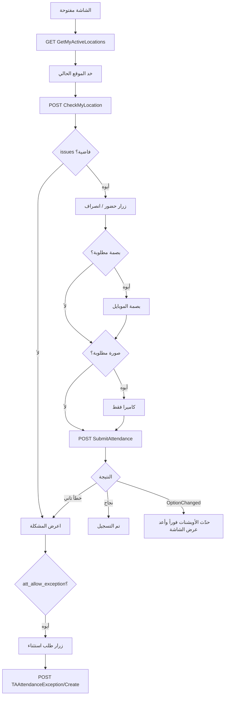

# Flow اللوجن + الحضور والانصراف بالموبايل (مختصر)

> كل الـ responses شكلها `{ statuscode, message, result, success }`. اللي مكتوب تحت هو أهم حاجة في `result` بس.
> القاعدة: **البك اند هو اللي بيقرر**. الموبايل بيستخدم الأوبشنات عشان يعرض الشاشة صح وبس.

---

## 0) اللوجن

| الخطوة | Endpoint | أهم ما في الـ result |
|---|---|---|
| Login | OpenIddict (`flutter_appauth`) | `access_token` |
| بيانات المستخدم | Admin `GetUserLoginWithRoleData` / `GetWFEmpIdByUser` | الأدوار و `wfEmpId` |
| سياق الموبايل | `GET /api/v1/TAEmpMobile/GetMyLoginContext?deviceId=` | `empId`, `employee{empId, empCode, empFullAraName, empFullLatName, branchId, branchAraName, branchLatName, departmentId, depAraName, depLatName}`, `paySlipId`, `deviceStatus`, `deviceRecordId`, `serverTime` |
| الإعدادات (Admin) | `GET /api/v1/GeneralSettingSide/GetEffectiveValuesByKeys?keys=att_require_location&keys=...` | `{ "att_*": value }` — نفس ترتيب الحساب: مستخدم ثم أدوار ثم فرع ثم `DefaultValue`؛ المفتاح غير المعرّف = `null` → الموبايل يطبّق القيمة الآمنة. تُستدعى بالتوازي مع `GetMyLoginContext` |
| ربط الجهاز | `POST /api/v1/TAEmpDevice/Register` body `{deviceId, deviceName, platform}` | `TAEmpDeviceDto`: `id`, `empId`, `deviceId`, `status`, `approvedBy`, `approvedAt`, `lastUsedAt` |

- `deviceStatus` من HR: `NotRegistered` / `Approved` / `Pending` / `Revoked` / `Suspended`. حالة `NotRequired` يحددها الموبايل لو `att_require_device` غير مفعّل.
- الجهاز الجديد يُسجَّل دائمًا `Pending` حتى يعتمده المسؤول. حدّ الأجهزة `att_max_devices` يُطبَّق عند الاعتماد من شاشة «أجهزة الموظفين» (لا يوجد اعتماد تلقائي).
- الموبايل بيحفظ `deviceStatus` مع وقت الحفظ (`user_device_status`, `user_device_status_at`).

---

## 1) فتح أي شاشة حضور

| الخطوة | Endpoint | أهم ما في الـ result |
|---|---|---|
| تحديث السياق | `GET /api/v1/TAEmpMobile/GetMyLoginContext?deviceId=` | `deviceStatus` (+ `GetEffectiveValuesByKeys` للإعدادات) |

| `deviceStatus` | الرسالة |
|---|---|
| NotRegistered | هذا الجهاز غير مرتبط بحسابك، لذا فإن تسجيل الحضور غير متاح. |
| Pending | طلب ربط هذا الجهاز قيد المراجعة، وسيُتاح تسجيل الحضور بعد اعتماده. |
| Revoked | تم إلغاء ربط هذا الجهاز بحسابك، لذا فإن تسجيل الحضور غير متاح. |
| Suspended | تم إيقاف هذا الجهاز مؤقتًا، لذا فإن تسجيل الحضور غير متاح. |

إدارة الأجهزة (أدمن): `GET TAEmpDevice/GetList?empId=&status=`، `POST Approve?id=`، `POST Revoke?id=`، `POST Suspend?id=`.

---

## 2) تسجيل حضور / انصراف

| الخطوة | Endpoint | أهم ما في الـ result |
|---|---|---|
| المواقع المتاحة | `GET /api/v1/TABGPSLocation/GetMyActiveLocations` | `name`, `latitude`, `longitude`, `radiusMeters` |
| فحص الموقع | `POST /api/v1/TAEmpMachineAttendance/CheckMyLocation` | `nearestLocation`, `distanceMeters`, `isInside`, `issues` |
| حفظ الحضور | `POST /api/v1/TAEmpMachineAttendance/SubmitAttendance` | `id`, `attendanceTypeCode` (1 حضور، 2 انصراف) |
| استثناء / يدوي | `POST /api/v1/TAAttendanceException/Create` | `id` (الطلب Pending لحد الموافقة) |

**أكواد الأخطاء:** `OUT_OF_RANGE`, `STALE_LOCATION`, `LOW_ACCURACY`, `MOCK_LOCATION`, `NO_ASSIGNED_LOCATION`, `DEVICE_NOT_APPROVED`, `BIOMETRIC_REQUIRED`, `PHOTO_REQUIRED`, `OptionChanged`.

---

## اعتماد الأجهزة من الويب
- تعرض شاشة «أجهزة الموظفين» (hr-system/ta-emp-devices) الأجهزة المعلّقة افتراضيًا مع فلاتر الفرع والقسم والموظف والحالة.
- تقرأ الشاشة الإعداد att_max_devices من Admin GeneralSettingSide/GetEffectiveValuesByKeys وتنبّه أو تمنع الاعتماد عند بلوغ الحد، وتمرّره كـ maxDevices إلى Approve/BulkApprove ليتحقق الخادم ويعيد 409 عند التجاوز.
- يبقى تسجيل الجهاز (Register) و GetMyLoginContext متاحين للموظف دون صلاحية كيان (HRSkipEntityAuthorization).
