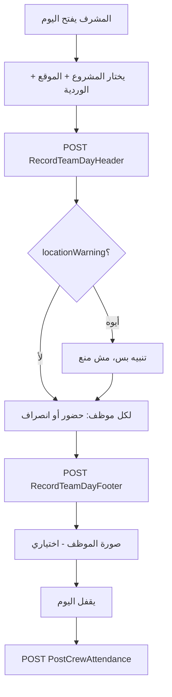

# Flow فريقي اليوم - المشرف (مختصر)

> كل الـ responses شكلها `{ statuscode, message, result, success }`. اللي مكتوب تحت هو أهم حاجة في `result` بس.
> الأوبشنات بتتقرا بـ `GetEffectiveValueBySetting`، والبك اند هو اللي بيقرر.

## الخطوات

| الخطوة | Endpoint | أهم ما في الـ result |
|---|---|---|
| بداية اليوم | `POST /api/v1/TDProject/RecordTeamDayHeader` | `header.id`, `locationWarning` |
| حضور/انصراف موظف | `POST /api/v1/TDProject/RecordTeamDayFooter` | `items[].id`, `warnings[]` |
| الصور | multipart `DataWithAttchments` (`MenuKey='TeamDay'`) | `RecordId` = id الموظف أو الـ header |
| قفل اليوم | `POST /api/v1/TDProject/PostCrewAttendance` | نجاح / فشل |

## مراجعة حضور فريق اليوم (ويب)

- الشاشة: `hr-system/td-attendance-review/:id`، وبتتفتح جنب شاشة مشاريع الفريق.
- البك اند بيحسب المسافة وداخل/خارج النطاق وقت التسجيل ويخزنهم: في الـ header `distancemeters, insidegeofence`، وفي الـ footer `in/outdistancemeters, in/outinsidegeofence`. السجلات القديمة بتتحسب وقت العرض.
- النطاق المسموح = `TDLocation.DiameterMeters`، ولو فاضي يبقى `TABGPSLocation.RadiusMeters`.
- حالة المراجعة على الـ footer: `reviewstatus` (0 قيد المراجعة، 1 معتمد، 2 مرفوض)، ومعاها `reviewedbyid, reviewedat, reviewnotes`.

| الغرض | Endpoint |
|---|---|
| قائمة السجلات | `GET /api/v1/TDProject/TeamDayReviewHeaders?day=&projectId=&shiftId=&locationId=` |
| التفاصيل (الموقع + النقاط + الموظفين) | `GET /api/v1/TDProject/TeamDayReviewDetail?headerId=` |
| اعتماد/رفض | `POST /api/v1/TDProject/ReviewTeamDayLines` `{headerid, lineids[], reviewstatus, reviewnotes}`. لو `lineids` فاضية يتعمل اعتماد جماعي للمعلّق بس |
| الترحيل | `POST /api/v1/TDProject/PostCrewAttendance` (نفس الـ endpoint، و`empid` اختياري للترحيل لموظف واحد) |

- **قاعدة:** السطر المرفوض مش بيترحّل أبدًا، والسطر المترحّل مش بيتراجع.
- **الصور:** `MenuKey='TeamDay'`. صورة فتح اليوم `recordid = header.id` و`pageParameter='header'`، وصور الحضور والانصراف `recordid = line.id` و`pageParameter='in'|'out'`.

## المشرف هو اللي بيسجّل (العمال من غير موبايل)

- موبايل المشرف بيسجّل كل حاجة. بيصوّر كل عامل وبيبعت اللوكيشن وقت التصوير، فلوكيشن حضور وانصراف الـ footer هو لوكيشن موبايل المشرف.
- لوكيشن الـ header = حضور المشرف، و`supervisorintime` بيتسجّل في `RecordTeamDayHeader`.
- قفل اليوم: `POST /api/v1/TDProject/CloseTeamDayHeader` `{headerId, latitude, longitude, locationAccuracyMeters, recordedAt}`. بيسجّل `supervisorouttime` و`outlatitude/outlongitude/outlocationaccuracymeters` و`outdistancemeters/outinsidegeofence`، والحالة بتبقى Closed. الـ header المقفول لسه ممكن يترحّل.
- شاشة المراجعة بتعرض نقطتين للمشرف (حضور وانصراف)، وبتنبّه لو السطر متسجّل قبل حضور المشرف أو بعد انصرافه، أو لو 5 سطور أو أكتر اتسجّلوا في نفس الدقيقة (احتمال إدخال جماعي).

## شاشة فريقي اليوم (الويب) - التسجيل بالموقع والصورة

- **بدء يوم العمل:** زر في شريط المشروع ينادي `RecordTeamDayHeader` بموقع المشرف (وصورة اختيارية إن كان `att_require_photo` مفعّلًا)، ويُنشئ الهيدر ويسجل `SupervisorInTime`.
- **إنهاء يوم العمل:** ينادي `CloseTeamDayHeader` بموقع الخروج، وتصبح الحالة Closed. يظهر فقط والهيدر Open أو Prepared.
- **حضور/انصراف لكل موظف:** زر الصف (حسب اختيار حضور/انصراف) ينادي `RecordTeamDayFooter` بموقع المشرف وقت الصورة، ثم تُرفع الصورة عبر `TABAttachements/GenaricAttachByNumber` بـ `MenuKey=TeamDay` و`pageParameter` = `in` أو `out` و`recordid` = رقم سطر الفوتر (للهيدر `header` ورقم الهيدر). الوقت المسجل هو وقت التسجيل الفعلي.
- **التسجيل الجماعي:** متاح للموقع فقط، ولا يعمل عند اشتراط الصورة (`att_require_photo`).
- **الأوبشنز المقروءة من الأدمن:** `att_require_location` و`att_require_photo` و`att_allow_exception` و`td_post_from_admin`. إن تعذر الموقع أو الصورة وكان الاستثناء مسموحًا، يطلب النظام تأكيد المتابعة كاستثناء، وإلا تُرفض العملية.
- **`td_post_from_admin`:** الافتراضي `true`، وعند تفعيله يختفي زرا ترحيل الهيدر وترحيل الموظف من الشاشة ويتم الترحيل من شاشة المراجعة. القرار في الفرونت فقط.
- لا يطبّق الويب البصمة الحيوية ولا تسجيل الجهاز (يُفحصان عند الدخول في الموبايل)، ولا يكشف الموقع الوهمي (mock).